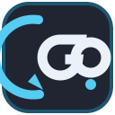

<p align="center">
  
</p>

<h1 align="center">GO. Game Engine</h1>

<p align="center"><strong>GO.</strong> + „dort“ – ein echter Full-Fork der Godot Engine mit
integrierter Git Suite und Code Agentics direkt im Editor.</p>

> **GO. Game Engine is an unofficial fork of the Godot Engine.**
> Godot's MIT license, copyright notices, authors and donors are preserved. This project is
> not affiliated with or endorsed by the Godot Foundation.

**English summary:** GO. Game Engine is a native fork of Godot 4.7.2-stable. It adds two
built-in editor suites — a host-neutral Git client with Git LFS and an anonymous, free-model
Kilo Gateway coding agent — plus a curated offline plugin bundle. The numeric engine version
remains Godot-compatible; the GO. release label is `4.7.2.go.0.1.0`. Windows and Linux
editor/export builds are produced by GitHub Actions. C#/.NET and macOS signing are out of
scope for this release.

---

## Status

Dieser Fork wird gerade aus der Anforderungsdatei `PROMPT.md` heraus aufgebaut. Der stabile
Arbeitsstand, gepinnte Referenzen und der ehrliche Fortschritt stehen in
[`docs/go/ROADMAP.md`](docs/go/ROADMAP.md). Bereits umgesetzt sind die stabile Godot-Basis,
GO.-Branding/Version, beide Splash-Bilder mit dem exakten Schriftzug
`A Godot Game Engine Fork by SampleCraft` in der frei lizenzierten Monocraft-Pixel-Font sowie
die Dokumentations- und Lizenzgrundlage. Features, die nur in CI oder einem kompilierten Editor
beweisbar sind, werden im Roadmap-Dokument ausdrücklich als offen markiert.

## Die zwei Suites

1. **GO. Git Suite** — Status, Stage/Unstage, Diff, Commit, Pull/Push, Verlauf, Remote-Assistent
   für GitHub/Codeberg/GitLab/Custom, automatische Git-LFS-Einrichtung und der deterministische
   **Automatic Commit** mit vollständiger UI-Sperre. Credentials bleiben beim System-Git.
2. **Code Agentics** — ein nativ nachgebauter, umgebrandeter Kilo-Free-Agent. Ausschließlich
   anonyme Gratis-Modelle über das Kilo Gateway, Standard `kilo-auto/free`; kein Login, keine
   API-Keys, keine Provider-Auswahl, keine MCP-Server, kein Workspace-Wechsel. Der Workspace ist
   immer `res://` des offenen Projekts.

Beide Suites sind als Editor-Modul einkompiliert und erscheinen als andockbare Tabs am rechten
Editor-Rand. Sie sind keine nachinstallierten Projekt-Addons.

## Gebündelte Plugins

Der Fork enthält ein versioniertes, offline verfügbares Plugin-Bundle. Reine GDScript-Addons
werden bei neuen Projekten nach `res://addons/` kopiert; GDExtensions werden im Release-Bundle
für Windows/Linux mitgeliefert. Die genauen Pins, Lizenzen und Aktivierungsregeln stehen in
[`docs/go/PLUGINS.md`](docs/go/PLUGINS.md) und `go_bundled_plugins/plugins.json`.

## Bauen

Die genauen Befehle für Windows und Linux stehen in
[`docs/go/BUILDING.md`](docs/go/BUILDING.md). Kurzfassung:

```sh
python3 -m pip install scons==4.9.1
scons platform=linuxbsd target=editor arch=x86_64 no_editor_splash=no production=yes
```

Wichtig: `short_name = "go"` ändert Binary-, Template- und User-Data-Namen. Daher braucht GO.
eigene Export-Templates; offizielle Godot-Templates sind nicht kompatibel. Der Editor-Splash
benötigt `main/splash_editor.png` und `no_editor_splash=no`.

Die Splash-Bilder sind reproduzierbar:

```sh
python3 -m pip install Pillow
python3 go_assets/make_splash.py
python3 go_assets/make_splash.py --check
```

## Tests und Guardrails

```sh
python3 misc/scripts/go_run_guardrails.py
python3 misc/scripts/go_check_ui_guardrails.py
python3 misc/scripts/go_validate_plugins.py
python3 misc/scripts/go_mock_gateway_test.py
```

Diese Prüfungen sind ohne kompilierten Editor ausführbar und laufen im schnellen PR-Workflow.
Der große Workflow baut Editor und Export-Templates für Windows und Linux.

## Lizenzen und Credits

- Godot Engine: MIT, siehe [`LICENSE.txt`](LICENSE.txt), [`COPYRIGHT.txt`](COPYRIGHT.txt),
  [`AUTHORS.md`](AUTHORS.md) und die unveränderte Upstream-README
  [`README.godot-upstream.md`](README.godot-upstream.md).
- Kilo Code / opencode: MIT, siehe [`docs/go/licenses/KILO-MIT.txt`](docs/go/licenses/KILO-MIT.txt).
- Monocraft: SIL OFL 1.1, siehe
  [`go_assets/fonts/LICENSE-Monocraft.txt`](go_assets/fonts/LICENSE-Monocraft.txt).
- Alle gebündelten Plugins: eigene License-Datei und Pin im Bundle.

Die vollständige Übersicht steht in
[`docs/go/THIRD_PARTY_NOTICES.md`](docs/go/THIRD_PARTY_NOTICES.md). „Minecraft“ beschreibt nur
den Stil der frei lizenzierten Pixel-Font; es werden keine Mojang- oder Microsoft-Assets
verteilt.

## Upstream synchron halten

```sh
git remote add upstream https://github.com/godotengine/godot.git  # einmalig
git fetch upstream --tags
git rebase upstream/<neues-stabiles-tag>
```

Alle bewusst geänderten Upstream-Dateien sind mit `// GO.` (bzw. `# GO.` in Python) markiert
und in [`docs/go/UPSTREAM_PATCHES.md`](docs/go/UPSTREAM_PATCHES.md) dokumentiert. Die gewählte
Basis und externe Referenz-Commits stehen in
[`docs/go/BASE_VERSION.md`](docs/go/BASE_VERSION.md).
